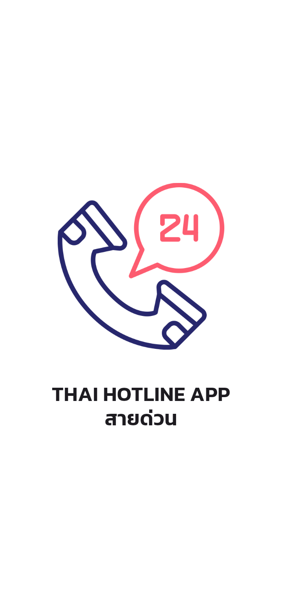
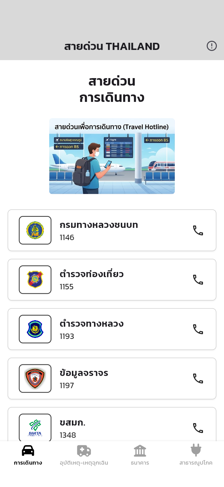
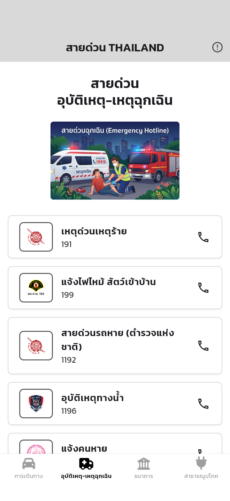
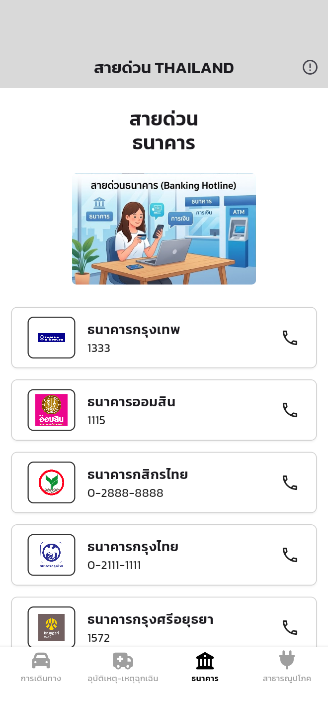
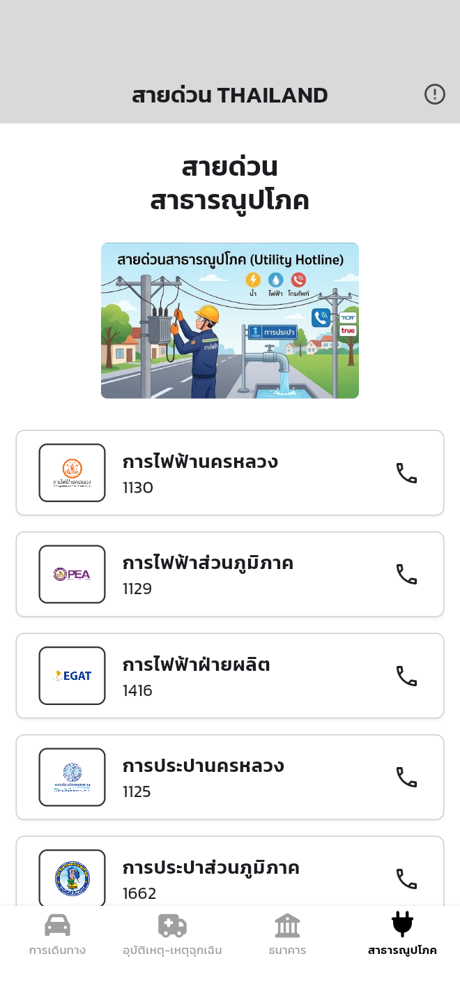
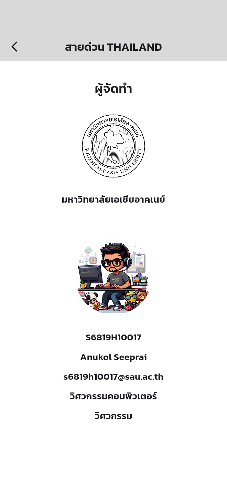

# 07-flutter_thai_hotline_app

**สายด่วน THAILAND** — a Thai hotline app built from the Figma wireframe
"Mobile App: flutter_thai_hotline_app" (tested at iPhone 16 Pro Max size, 440 x 956).
Main font: Kanit (google_fonts). Tap a hotline card or its phone icon to call (url_launcher).

## Screenshots

Captured from the running app at iPhone 16 Pro Max size (440 x 956).

<table>
  <tr>
    <td align="center"><br><b>SplashScreenUI</b><br>หน้าแรก</td>
    <td align="center"><br><b>TravelUI</b><br>การเดินทาง</td>
    <td align="center"><br><b>EmgUI</b><br>อุบัติเหตุ-เหตุฉุกเฉิน</td>
  </tr>
  <tr>
    <td align="center"><br><b>BankUI</b><br>ธนาคาร</td>
    <td align="center"><br><b>PubUI</b><br>สาธารณูปโภค</td>
    <td align="center"><br><b>AboutUI</b><br>ผู้จัดทำ</td>
  </tr>
</table>

## Screens

| File | Class | Screen |
| --- | --- | --- |
| `lib/views/splash_screen_ui.dart` | `SplashScreenUI` | First page, goes to HomeUI after 3 seconds |
| `lib/views/home_ui.dart` | `HomeUI` | AppBar + BottomNavigationBar that switches TravelUI, EmgUI, BankUI, PubUI |
| `lib/views/travel_ui.dart` | `TravelUI` | สายด่วน การเดินทาง (9 numbers) |
| `lib/views/emg_ui.dart` | `EmgUI` | สายด่วน อุบัติเหตุ-เหตุฉุกเฉิน (9 numbers) |
| `lib/views/bank_ui.dart` | `BankUI` | สายด่วน ธนาคาร (16 numbers) |
| `lib/views/pub_ui.dart` | `PubUI` | สายด่วน สาธารณูปโภค (9 numbers) |
| `lib/views/about_ui.dart` | `AboutUI` | ผู้จัดทำ (opened from the info icon) |

Shared parts: `lib/models/hotline.dart` (data) and `lib/widgets/hotline_widgets.dart` (list + card).

## Images

All images come from the course resource folder `resource-flutter-thai-hotline-app`:

| Folder | Used for |
| --- | --- |
| `assets/images/travel/` | `travel_0` banner + 9 logos |
| `assets/images/emergency/` | `emg_0` banner + 9 logos |
| `assets/images/bank/` | `bank_0` banner + 16 logos |
| `assets/images/pubutil/` | `pub_0` banner + 9 logos |
| `assets/images/aboutme/` | University logo and profile picture |
| `assets/icon/icon.png` | Splash logo and launcher icon (flutter_launcher_icons) |

Each list follows the image numbers: item 1 uses `_1.png`, item 2 uses `_2.png`, and so on.

## Run

```sh
flutter pub get
flutter run -d chrome
```

## Quality checks

```sh
flutter analyze
flutter test
```
